

  <a href="https://portfolio-mohamedwaelbishrs-projects.vercel.app">
    
  </a>

  
  
  
  
  

 

<picture>
  <source media="(prefers-color-scheme: dark)" srcset="assets/headers/about-dark.svg" />
  
</picture>

I build the screens where decisions get made.

**Now** — real-time financial dashboards at **Octane**: transaction monitoring, risk assessment, analytics that update while you watch. A dropped frame or a mislabeled axis costs someone money, so I own both halves: the render path *and* the pixel.

**Before** — full-stack at **Everest Minds**, shipping process-automation tools and cross-platform healthcare apps with React, NestJS, Angular, React Native, MySQL and MongoDB. Features owned end to end, design through deploy.

**Origin** — biomedical and telecom field ops: complex hardware, compliance, real consequences. That's where I learned most bugs are systems problems wearing a code costume.

 

<picture>
  <source media="(prefers-color-scheme: dark)" srcset="assets/headers/now-dark.svg" />
  
</picture>


 

<picture>
  <source media="(prefers-color-scheme: dark)" srcset="assets/headers/stack-dark.svg" />
  
</picture>


 

<picture>
  <source media="(prefers-color-scheme: dark)" srcset="assets/headers/work-dark.svg" />
  
</picture>

  <a href="https://www.open-gebra.com"></a>

  <a href="https://portfolio-mohamedwaelbishrs-projects.vercel.app"></a><a href="https://mocklyst.vercel.app"></a>

  <a href="https://teacher-toolbox-frontend.vercel.app"></a><a href="https://azooz-lms-nextjs.vercel.app"></a>

  <a href="https://github.com/MohamedWaelBishr/raycast-prompt-enhancer"></a><a href="https://github.com/MohamedWaelBishr/react-turbo-select"></a>

every card is a link · <a href="https://portfolio-mohamedwaelbishrs-projects.vercel.app">more on the portfolio →</a>

<picture>
  <source media="(prefers-color-scheme: dark)" srcset="assets/headers/ship-dark.svg" />
  
</picture>


 

<picture>
  <source media="(prefers-color-scheme: dark)" srcset="assets/headers/telemetry-dark.svg" />
  
</picture>

  

  

  

  <picture>
    <source media="(prefers-color-scheme: dark)" srcset="https://raw.githubusercontent.com/MohamedWaelBishr/MohamedWaelBishr/output/snake.svg" />
    
  </picture>

 

<a href="mailto:mohamedwaelbishr@gmail.com"></a>
